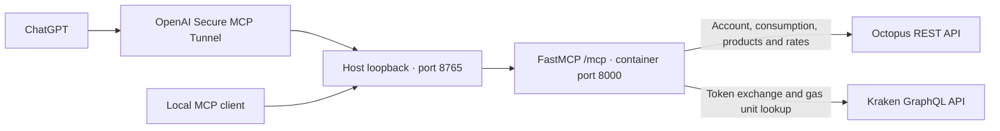

# Octopus MCP architecture

Octopus MCP serves one configured Octopus Energy account. Clients retrieve interval readings, meter metadata and published prices for analysis in ChatGPT or Jupyter. The Python process has no application database. Tool results, including household identifiers and usage, travel back to the client and are subject to its retention settings.

## Running system

The tunnel is configured separately by the operator. Compose publishes the container's `0.0.0.0:8000` listener on `127.0.0.1:8765`. FastMCP serves stateless Streamable HTTP with JSON responses. The application has no caller authentication. Any caller with network access to the listener can use the configured account, including peers that can reach the container directly. Meter ownership checks limit the selected meter to that account. The deployment guide covers tunnel setup and verification. [README](../README.md)

### Tool surface

All seven synchronous tools, their domain logic and the HTTP adapters live in [server.py](../server.py).

| Tool | Data flow and result |
| --- | --- |
| `list_meters` | Reads account properties and groups meter candidates and agreements by supply point. Returns the compatible flat meter list alongside selection metadata. |
| `consumption` | Matches fuel, point and serial against the account inventory before fetching readings. Returns sorted half-hours, coverage gaps, overlapping agreements and measurement metadata. |
| `tariff_products` | Pages through published products at a timezone-aware instant. Household eligibility is unknown. |
| `tariff_product` | Retrieves one product and its regional variants. |
| `tariff_rates` | Retrieves standard unit rates and standing charges for electricity or gas. |
| `tariff_dual_rates` | Retrieves electricity day, night and standing-charge records. |
| `tariff_ev_rates` | Retrieves four published electricity rate bands and standing charges, with source URLs and empty categories. |

Consumption and rate requests accept up to 31 inclusive UK dates. Local midnight boundaries in `Europe/London` define a half-open UTC window. Consumption excludes out-of-window readings, rejects duplicate or misaligned half-hours and represents gaps explicitly. A UK day can contain 46, 48 or 50 half-hours. Agreement validity and physical meter installation dates are separate facts. Multiple serials can remain ambiguous even when one agreement is active.

Electricity consumption is in kWh. Gas readings retain the reported unit where available. A failed metadata lookup returns readings with a unit status of `lookup_failed`, while an absent meter unit yields `unavailable_for_meter`. Clients combine usage and prices, preserving VAT basis, validity periods, payment method, and the distinction between pence/kWh and pence/day. Published bands alone cannot establish switching hours or account-specific EV dispatch.

### Credentials, requests and failures

The process reads `OCTOPUS_ACCOUNT_NUMBER` and `OCTOPUS_API_KEY` at startup. REST GETs use HTTP Basic authentication against the Octopus API. For gas metadata, the service posts the key to the fixed Kraken GraphQL token endpoint, then sends the returned token in the Authorization header to that same endpoint to query the account. This token exchange supports read-only energy queries.

HTTPX disables redirect following and uses a 30-second timeout on network operations. Each page opens a new client. Pagination stops after 20 pages per collection. Those limits leave the total call duration and response bytes uncapped by the application. Consumption, product catalogue and rate tools share a validator that requires each page to be a JSON object with a results list, which can be empty. Repeated continuation links and malformed pages fail the entire tool call. REST transport, status and JSON errors produce short tool errors without request URLs or response bodies.

REST GETs resolve pagination links against the REST API base and validate the HTTPS origin before sending Basic credentials. The Kraken host is accessed only through the fixed GraphQL endpoint. Treat request URLs as sensitive because paths can contain account numbers, meter points and serials. [Contributor guide](../AGENTS.md)

### Packaging and release

The Python 3.12 image runs under UID/GID 65534. Compose sets a read-only filesystem, drops Linux capabilities and enables no-new-privileges. CI runs pytest on pushes and pull requests. Container PR builds targeting main build the image locally on the runner. Pushes to main and manual workflow runs publish linux/amd64 images to GHCR tagged with the commit SHA and latest. Updating the running Docker host is a separate operator action. [Container workflow](../.github/workflows/container.yml) · [Compose configuration](../compose.yaml)

## Target design

Extract modules incrementally as changes create a reason to do so. Keep tool registration in the server, isolate transport and credential handling in a client, and group meter selection, interval coverage, UK time windows, tariff discovery and rate normalization by responsibility. Share normalized models where callers need stable contracts. Adapter hardening includes bounded response sizes, same-origin pagination, redacted errors and bounded retries for transient failures.

A future optional Home Assistant adapter would supply allowlisted solar, EV charger and battery telemetry using protected, minimal-access credentials. Keep measured and inferred quantities distinct. Pricing and battery simulation belong in clients. Device control requires its own authorization and safety design. The roadmap tracks live verification and feature status. [Decisions](DECISIONS.md) · [Roadmap](ROADMAP.md)
